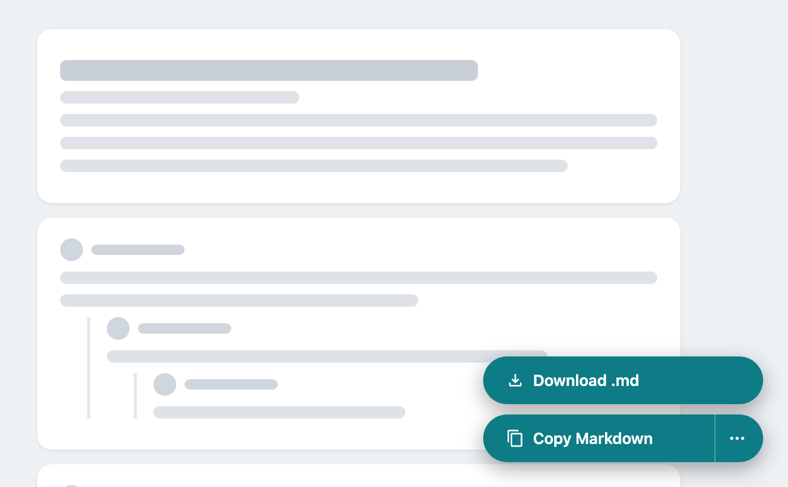
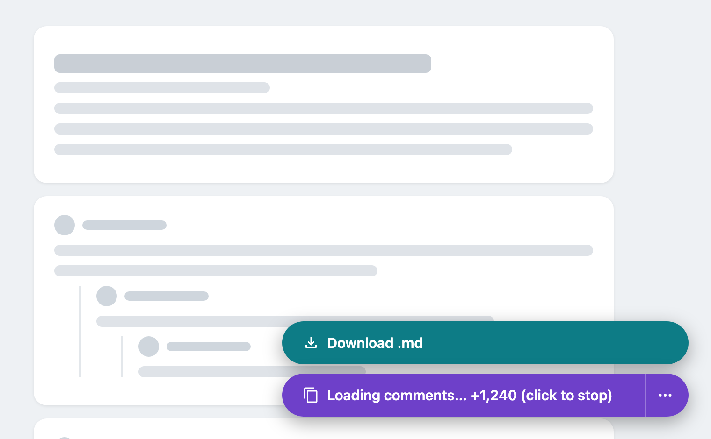
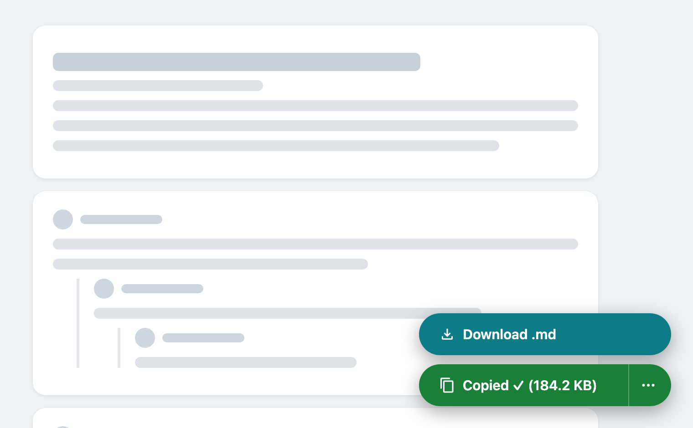
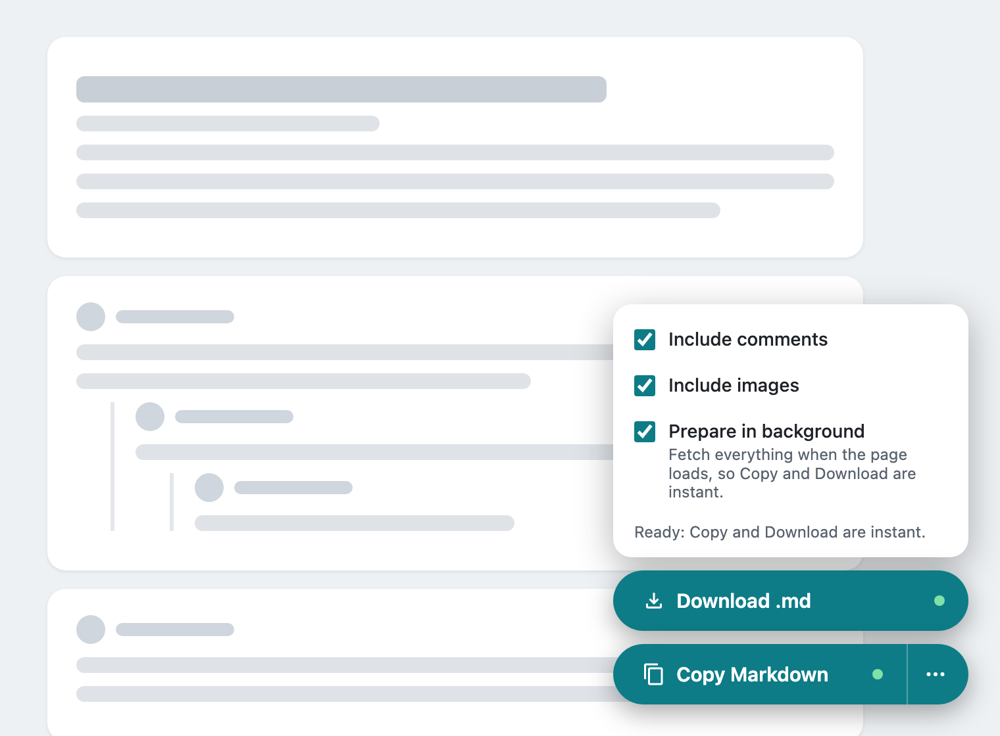

# Copy as Markdown: Reddit + YouTube

A Chrome extension that turns a Reddit thread, a YouTube video or a YouTube Short into clean Markdown with one click. It includes the post or video, its metadata, and every comment and reply. Copy it to the clipboard or download it as a `.md` file.

Paste the result into an LLM, your notes app, Obsidian, or a GitHub issue. No API key, account, or server is needed.

<p align="center"></p>

## Features

**Reddit** (`reddit.com/r/*/comments/*`)
- Title, subreddit, author, score, upvote ratio, date, flair, and crosspost source
- Post body, images, galleries, and video links
- The full comment tree, with author, score, and date on every comment, plus OP, pinned, and edited markers
- Expands "load more" and "continue this thread" branches automatically

**YouTube** (`youtube.com/watch?v=*` and Shorts at `youtube.com/shorts/*`)
- Title, channel, subscribers, publish date, duration, views, likes, category, tags, description, and thumbnail
- Every comment with all its replies, likes, and age, plus pinned and creator-heart markers

**Both**
- Two floating buttons in the bottom-right corner:
  - **Download .md** saves the Markdown as a file named after the post or video title
  - **Copy Markdown** copies it to the clipboard
- **Prepare in background** (off by default; turn it on in the **⋯** menu): fetches everything quietly once the page loads, so Copy and Download are instant. Nothing is saved to your Downloads folder until you click. A green dot on the buttons means the result is ready. The prefetch runs only in visible tabs, waits for idle time between requests, and uses fewer parallel requests, so the page stays responsive.
- A **⋯** menu with the **Prepare in background**, **Include comments** and **Include images** toggles, remembered between visits
- Live progress on large threads
- Click again while it is loading to stop early and keep what has loaded so far

### Screenshots

| Fetching a large thread | Done |
|---|---|
|  |  |
| Live progress. Click again to stop and keep what has loaded. | Shows the size of what was copied or downloaded. |

| Options menu, with the result prepared in the background |
|---|
|  |
| The green dots mean the result is ready, so Copy and Download are instant. |

*The screenshots show the extension's real buttons on a placeholder page.*

## Install

The extension is not on the Chrome Web Store yet. To install it from this repo:

1. Download it: **Code → Download ZIP** on GitHub, then unzip it. You can also run `git clone https://github.com/heysujal/reddit-yt-in-markdown-chrome-extension.git`.
2. Open `chrome://extensions` and turn on **Developer mode** (top right).
3. Click **Load unpacked** and select the unzipped folder (the one that contains `manifest.json`).
4. Reload any Reddit or YouTube tab that was already open.

It also works in Chromium-based browsers such as Edge, Brave, and Arc.

## Usage

1. Open a Reddit post, a YouTube video or a YouTube Short.
2. Click **Copy Markdown** to copy it, or **Download .md** to save it as a file. If **Prepare in background** is on and the green dot is showing, the result is already prepared and arrives instantly.
3. Wait for the "Copied ✓" or "Downloaded ✓" confirmation.

## Example output

```markdown
# What's a tool you can't live without?

- **Subreddit:** r/programming
- **Author:** u/example_user
- **Posted:** 2026-11-10 14:32 UTC
- **Score:** 1,284 (96% upvoted)
- **Comments:** 312
- **URL:** https://www.reddit.com/r/programming/comments/...

---

Post body here...

---

## Comments (312 copied)

- **u/someone** · ⬆ 412 · 2026-11-10 15:01 UTC

  First comment text.

  - **u/example_user** (OP) · ⬆ 88 · 2026-11-10 15:20 UTC

    A nested reply.
```

## Limitations

### Rate limits

The extension makes the same requests the site would make if you clicked every "load more" yourself, just much faster. A small post needs 1 to 5 requests. A huge thread or a video with thousands of comments can need hundreds.

- **Reddit may rate-limit you.** Reddit doesn't publish a limit for logged-in browsing, and big threads send many requests in a row, up to 400 per post. If you copy several very large threads back to back, Reddit may start answering with `429 Too Many Requests` for a while. That can also affect your normal browsing on Reddit until it resets.
- **Prepare in background adds to this.** With it on, every post or video you open is fetched in full, even if you never copy it. If you browse many large threads, or Reddit starts refusing requests, turn it off in the **⋯** menu.
- **YouTube** is more tolerant, but a video with tens of thousands of comments still takes hundreds of requests to its comments API.
- **Shorts and Prepare in background:** each Short you swipe to (and stay on for about 1.5 seconds) starts its own background fetch. Swiping away cancels it, but scrolling through many Shorts still adds up. Turn the option off if you binge Shorts.
- **There is no retry or back-off yet.** On Reddit, a failed request (including a 429) is skipped, so those comments are silently missing from the output. On YouTube, a failed comments request stops the run with an error.
- **The output may be incomplete.** If Reddit's 400-request cap is reached, or you stop a run early, the output says so in a note at the top of the comments.

### Data

- **Only what you can see.** The extension uses your own session, so private, quarantined, age-gated or members-only content is included only if your account can open it. Deleted and removed comments appear as `[deleted]` or `[removed]`, the way Reddit returns them.
- **YouTube numbers are often rounded.** Comment likes and some video likes come as YouTube displays them (for example `1.2K`). Comment dates are relative (`2 weeks ago`), not exact timestamps.
- **YouTube comments use the Top sort** (YouTube's default), not Newest.
- **Reddit dates are in UTC.**
- **Images are links, not files.** Images are included as Markdown image links to Reddit's or YouTube's servers. They may stop loading if the original is deleted.

### Stability

- **Unofficial endpoints.** Both sites' internal endpoints and page data are undocumented and can change without notice. If a site changes them, copying may fail or miss fields until the extension is updated.
- **Clipboard timing.** If you click **Copy Markdown** and the fetch takes a long time, Chrome may refuse the clipboard write. The button then says "Ready — click again to copy", and one more click copies it. **Download .md** isn't affected.
- **Chromium only.** The extension is built for Chrome and Chromium-based browsers. It has not been tested in Firefox or Safari.
- **Supported pages:** Reddit post pages (`/r/<sub>/comments/<id>/…`) YouTube videos (`/watch?v=…`) and Shorts (`/shorts/<id>`). Live chat, community posts, and subreddit or channel listings aren't supported.

## Privacy

- **No external calls.** The extension uses the same endpoints the sites already use, sent from your own tab:
  - Reddit: `/comments/<id>.json` and `/api/morechildren.json`
  - YouTube: the watch page's embedded data and `/youtubei/v1/next` for comment pages
- **No data collection.** Nothing leaves your browser. The output goes to your clipboard or a file you choose to download.
- **Permissions:** `clipboardWrite` to copy, and `storage` to remember your toggles.

## Project structure

```
├── manifest.json     # Manifest V3 config and content-script matches
├── icons/            # Extension icons (SVG masters + PNG sizes)
├── docs/screenshots/ # Images used in this README
└── src/
    ├── common.js     # Floating button, options menu, clipboard, download, helpers
    ├── reddit.js     # Reddit thread → Markdown
    └── youtube.js    # YouTube video or Short + comments → Markdown
```

## Development

There is no build step. Edit the files in `src/`, then click the reload icon on the extension card in `chrome://extensions` and refresh the tab.

## License

[MIT](LICENSE) © Sujal Gupta

This project is not affiliated with or endorsed by Reddit or YouTube. Use it in line with each site's terms of service.
